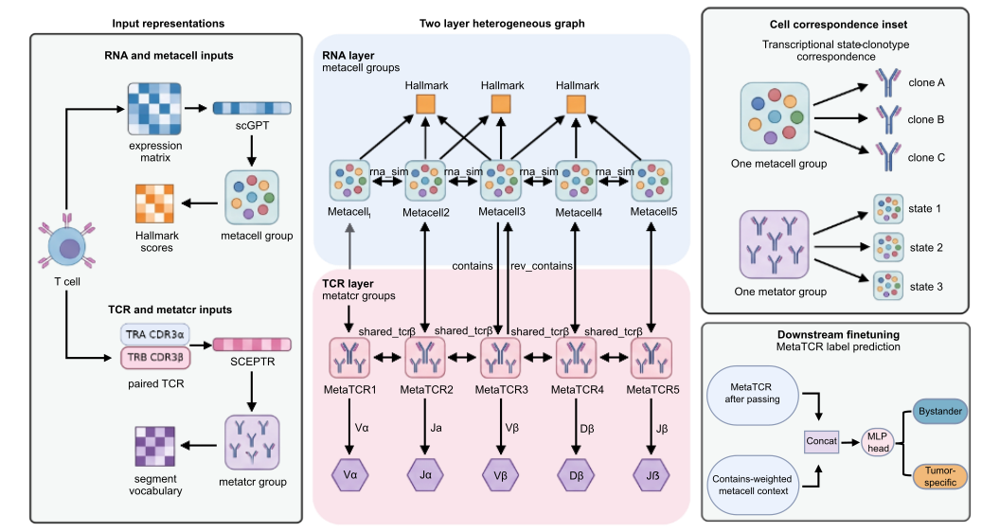

# BYSTER

**BYSTER: multimodal graph learning resolves bystander versus tumor-specific T cell states in the tumor immune microenvironment**

BYSTER is a multimodal graph learning framework for resolving bystander versus tumor-specific T cell states from matched single-cell RNA expression and TCR annotations. The updated workflow prepares RNA and TCR inputs for graph construction and downstream model inference.

## Release status

This repository is being updated to the new graph-based workflow. The previous implementation is no longer maintained and is incompatible with the updated model.

The current public tutorial covers input preparation and documents graph construction. A complete runnable release requires the matching graph-building scripts, model code, checkpoints, and a validated environment. These should not be substituted with files from the previous implementation.

The existing `bystander.yml`, `config.yaml`, `preview_pretrain.ipynb`, `preview_finetune.ipynb`, and legacy prediction scripts are not validated instructions for the updated workflow.

## Model overview

Additional framework views: [SVG](BYSTER_framework.svg) | [PDF](BYSTER_framework.pdf).

## Tutorial

Start with [new_dataset.ipynb](new_dataset.ipynb).

The tutorial includes:

- The AnnData input schema for matched RNA expression and TCR annotations.
- An illustrative cell metadata table.
- A graph-construction command for the matching implementation.
- An optional conversion example for matched 10x RNA and TCR files.
- RNA quality filtering, TCR chain selection, audit outputs, and H5AD read-back checks.

**If you already have a compatible H5AD file:** follow the input specification and inspect your data in the input-preview cell.

**If you start from 10x files:** first run the optional preparation section, then return to the input-preview cell. The preview expects `sample/sample_graph_input.h5ad` to exist.

Graph construction requires `creat_pretrain_graph.py` and its matching environment. This script is referenced by the tutorial but is not currently available in the inspected public directories. The tutorial does not yet include a complete checkpoint-to-prediction example.

## Input requirements

Provide an AnnData (`.h5ad`) file in which each row represents one cell. RNA expression and TCR annotations must refer to the same cell.

| Location | Requirement |
|---|---|
| `adata.layers['counts']` or `adata.X` | Nonnegative raw RNA counts, cells × genes. The documented loader uses `layers['counts']` when present, otherwise `X`. |
| `adata.var_names` | Unique gene symbols. |
| `adata.obs_names` | Unique cell IDs. Use sample prefixes when combining samples. |
| `adata.obs['patient_id']` | Nonmissing patient or donor ID. |
| `adata.obs['sample_id']` | Nonmissing sample or library ID. Each sample belongs to one patient. |
| `adata.obs['cdr3_aa_a']` | TRA CDR3 amino-acid sequence, when available. |
| `adata.obs['cdr3_aa_b']` | TRB CDR3 amino-acid sequence, when available. |

At least one CDR3 column is required. Under `--tcr-mode any`, each retained cell must have at least one nonmissing TRA or TRB CDR3 sequence. Under `--tcr-mode paired`, both chains are required. Do not invent sequences to fill missing chains.

Optional TCR gene annotations are `v_gene_a`, `j_gene_a`, `v_gene_b`, `d_gene_b`, and `j_gene_b`. Preserve valid annotations when available because they inform TCR encoding.

Apply cell-quality filtering before export and retain unnormalized RNA counts. Experimental labels are not required for inference in the documented workflow.

## Optional preparation from 10x files

Use matched files from the same cell library:

| File | Content |
|---|---|
| `barcodes.tsv.gz` | RNA cell barcodes |
| `features.tsv.gz` | RNA feature annotations |
| `matrix.mtx.gz` | RNA count matrix |
| `filtered_contig_annotations.csv.gz` | TCR contig annotations |

The tutorial matches RNA and TCR data by barcode, selects productive high-confidence TRA/TRB contigs, and chooses the highest-UMI contig per chain, with reads and contig ID used to resolve ties.

The example thresholds are at least 200 detected genes and at most 20% mitochondrial counts. Adjust these to your dataset. Mitochondrial detection assumes human gene symbols beginning with `MT-`.

The preparation example writes:

| Output | Content |
|---|---|
| `sample_graph_input.h5ad` | Cells passing RNA QC with at least one usable TCR chain |
| `{SAMPLE_ID}_rna_tcr_all.h5ad` | All input RNA cells with matched TCR annotations and QC flags |
| `{SAMPLE_ID}_contig_audit.csv.gz` | Contig selection audit |
| `{SAMPLE_ID}_pairing_qc.json` | Pairing and filtering summary |

Rerunning the example replaces outputs with the same names. Rebuild graphs whenever the input cells change.

## Issues

For questions or reproducibility problems, open an [issue](https://github.com/C8H8O-tenes/BTC/issues) and include the commit or release, environment details, command, and error message. Do not include private patient data.
